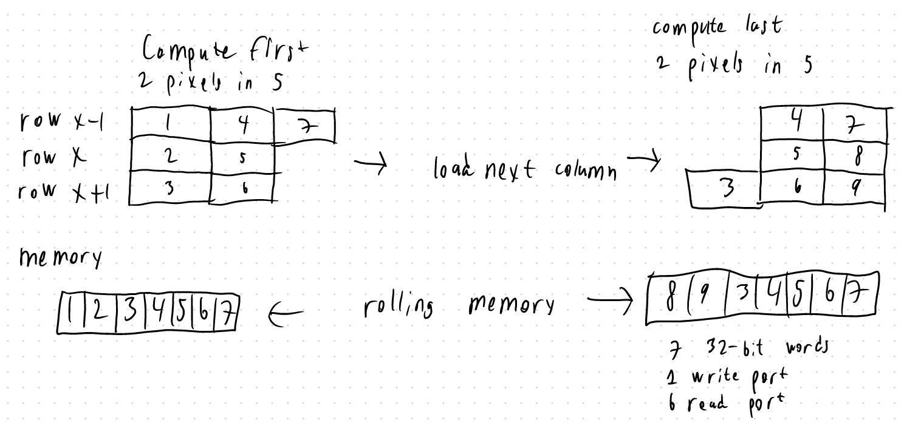
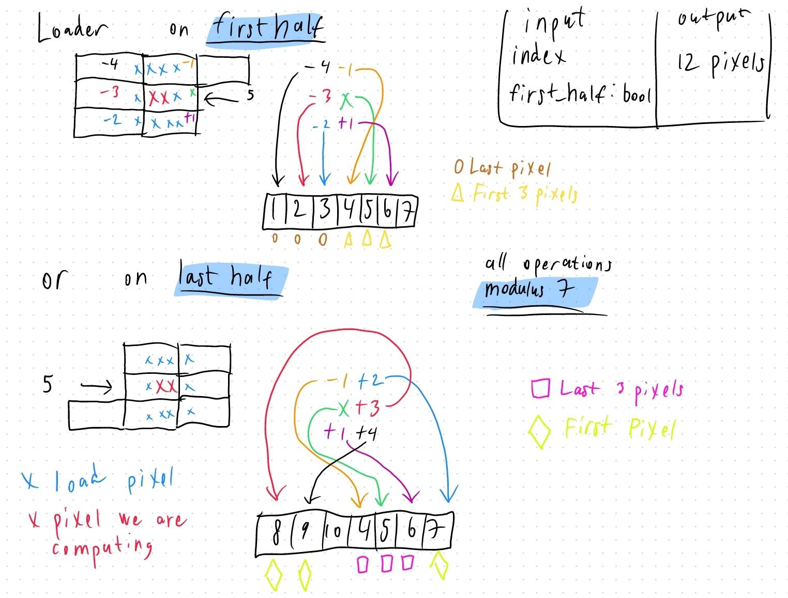

# Problems with original designs

  

    01
    <h3>Column-wise loading</h3>
    
Reconsidered when we needed to assemble four output pixels into one complete 32-bit write.

  

  

    02
    <h3>Large register file</h3>
    
About 600 words and nine read ports. A straightforward read-mux estimate alone used <strong>≈88% of available LUTs</strong>.

  

  

    03
    <h3>Develop a working version</h3>
    
Keep it simple and maybe slighlty less efficient. Then we can consider redesigning it

  

---

# Compute 1 row at a time and keep a rolling window of 7 words in memory

---

# Selecting the pixel neighbourhoods

---

# Status and Implementation Details

  

    <h3>Implemented</h3>
    <ul>
      <li>Memory</li>
      <li>Loader</li>
      <li>Parts of the FSM</li>
    </ul>
    
Today's goal: a running accelerator.

  

  

    <h3>Processing schedule</h3>
    <ul>
      <li>Two pixels computed in parallel</li>
      <li>Each input word read three times</li>
      <li>One word read per cycle</li>
    </ul>
    
≈1,315 frames/s

    
25,344 words/frame = 288 × 352 / 4 100,000,000 / (25,344 × 3) ≈ 1,315

  

Optimistic estimate at clock speed of 100MHz

---

# Finish, integrate, then optimize

  
01
<h3>Integrate with the SoC</h3>
Connect and verify the complete accelerator flow.

  
02
<h3>Improve buffering</h3>
Reuse data so each input word is read fewer times.

  
03
<h3>Add resource sharing</h3>
Reduce duplicated hardware where the schedule allows.

  
04
<h3>Support border pixels</h3>
Extend processing to the image boundaries.

